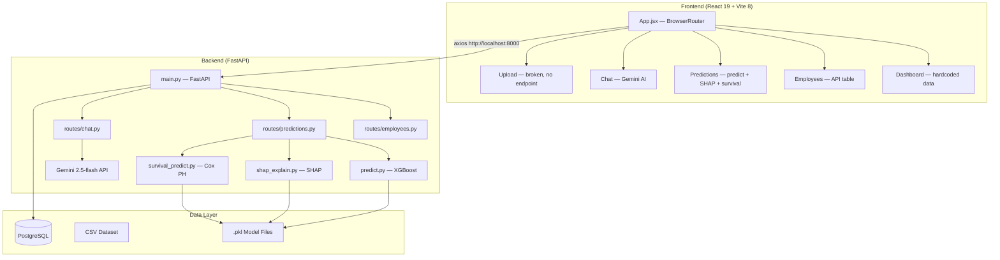

# Architecture — AttritionPulse AI

**Date:** 2026-11-15  
**Status:** Proposed — awaiting approval

---

## 1. Current Architecture



### Current Problems

- Flat file structure — all backend code in one directory
- No package structure (`__init__.py` missing)
- Model files loaded at import time with CWD-relative paths
- No migrations, no Docker, no tests, no CI
- Frontend entirely in JavaScript (no TypeScript)
- Dashboard charts use hardcoded demo data

---

## 2. Target Architecture — AttritionPulse AI

### 2.1. System Overview

```mermaid
graph TD
    subgraph "Frontend — React 19 + TypeScript + Vite"
        APP[App Router]
        APP --> DASH[Dashboard — live API data + Plotly.js]
        APP --> EMP[Employee Explorer — paginated, sortable]
        APP --> PRED[Prediction Center — SHAP waterfall + survival curve]
        APP --> CHAT[AI Assistant — streaming Gemini chat]
        APP --> UPLOAD[Data Upload — validated CSV ingestion]
        APP --> COHORT[Cohort Analysis — group comparisons]
        APP --> REPORT[Risk Reports — export PDF/CSV]
        APP --> SETTINGS[Settings — admin config]
    end

    subgraph "Backend — FastAPI + SQLAlchemy 2 + Alembic"
        MAIN[main.py — lifespan, middleware]
        MAIN --> API_EMP[/api/v1/employees]
        MAIN --> API_PRED[/api/v1/predictions]
        MAIN --> API_ANAL[/api/v1/analytics]
        MAIN --> API_CHAT[/api/v1/chat]
        MAIN --> API_UPLOAD[/api/v1/upload]
        MAIN --> API_REPORT[/api/v1/reports]

        API_PRED --> ML_SVC[ML Service Layer]
        ML_SVC --> XGB[XGBoost Classifier]
        ML_SVC --> SHAP_E[SHAP Explainer]
        ML_SVC --> COX[Cox PH Survival]
        ML_SVC --> COHORT_E[Cohort Engine]

        API_CHAT --> GEMINI[Gemini Service]
        API_ANAL --> STATS[Statistical Analytics]
    end

    subgraph "Data Layer"
        PG16[(PostgreSQL 16)]
        ALEMBIC[Alembic Migrations]
        REDIS[(Redis — optional cache)]
    end

    subgraph "Infrastructure"
        DC[Docker Compose]
        DC --> PG16
        DC --> REDIS
        DC --> BE_CONT[Backend Container]
        DC --> FE_CONT[Frontend Container]
    end

    APP -->|TanStack Query — /api/v1/*| MAIN
    MAIN --> PG16
    ALEMBIC --> PG16
```

### 2.2. Target Directory Structure

```text
workforce-attrition-ai/
│
├── frontend/
│   ├── src/
│   │   ├── api/                    # TanStack Query hooks + API client
│   │   ├── assets/                 # Static images, SVGs
│   │   ├── components/             # Shared UI components
│   │   │   ├── ui/                 # Base design system (Button, Card, Badge, etc.)
│   │   │   ├── charts/             # Plotly.js chart wrappers
│   │   │   └── layout/             # Shell, Sidebar, Header
│   │   ├── features/               # Feature-scoped components
│   │   │   ├── dashboard/
│   │   │   ├── employees/
│   │   │   ├── predictions/
│   │   │   ├── chat/
│   │   │   ├── upload/
│   │   │   └── reports/
│   │   ├── hooks/                  # Shared custom hooks
│   │   ├── layouts/                # Route layout wrappers
│   │   ├── pages/                  # Route-level page components
│   │   ├── routes/                 # React Router route config
│   │   ├── schemas/                # Zod validation schemas
│   │   ├── types/                  # TypeScript type definitions
│   │   └── utils/                  # Helpers, formatters, constants
│   ├── tests/                      # Vitest + React Testing Library
│   ├── e2e/                        # Playwright E2E tests
│   ├── package.json
│   ├── tsconfig.json
│   ├── vite.config.ts
│   └── tailwind.config.ts
│
├── backend/
│   ├── app/
│   │   ├── __init__.py
│   │   ├── main.py                 # FastAPI app factory + lifespan
│   │   ├── config.py               # Pydantic Settings
│   │   ├── api/
│   │   │   ├── __init__.py
│   │   │   ├── deps.py             # Shared dependencies (get_db, get_current_user)
│   │   │   └── v1/
│   │   │       ├── __init__.py
│   │   │       ├── router.py       # API v1 router aggregator
│   │   │       ├── employees.py
│   │   │       ├── predictions.py
│   │   │       ├── analytics.py
│   │   │       ├── chat.py
│   │   │       ├── upload.py
│   │   │       └── reports.py
│   │   ├── core/
│   │   │   ├── __init__.py
│   │   │   ├── security.py         # Auth utilities (future)
│   │   │   └── exceptions.py       # Custom exception handlers
│   │   ├── db/
│   │   │   ├── __init__.py
│   │   │   ├── session.py          # Engine + SessionLocal
│   │   │   ├── base.py             # DeclarativeBase
│   │   │   └── seed.py             # Data seeding logic
│   │   ├── models/
│   │   │   ├── __init__.py
│   │   │   ├── employee.py
│   │   │   └── prediction.py       # Separate prediction history table
│   │   ├── schemas/
│   │   │   ├── __init__.py
│   │   │   ├── employee.py
│   │   │   ├── prediction.py
│   │   │   └── chat.py
│   │   ├── services/
│   │   │   ├── __init__.py
│   │   │   ├── employee_service.py
│   │   │   ├── prediction_service.py
│   │   │   └── chat_service.py
│   │   ├── analytics/
│   │   │   ├── __init__.py
│   │   │   ├── cohort.py
│   │   │   ├── trends.py
│   │   │   └── statistics.py
│   │   └── ml/
│   │       ├── __init__.py
│   │       ├── classifier.py       # XGBoost wrapper
│   │       ├── explainer.py        # SHAP wrapper
│   │       ├── survival.py         # Cox PH wrapper
│   │       ├── preprocessor.py     # Shared preprocessing
│   │       ├── trainer.py          # Model training pipeline
│   │       └── models/             # .pkl files directory
│   ├── alembic/
│   │   ├── alembic.ini
│   │   ├── env.py
│   │   └── versions/
│   ├── tests/
│   │   ├── conftest.py
│   │   ├── test_employees.py
│   │   ├── test_predictions.py
│   │   └── test_ml.py
│   └── requirements.txt
│
├── data/
│   ├── raw/                        # Original IBM HR CSV
│   ├── processed/                  # Feature-engineered data
│   ├── synthetic/                  # Generated longitudinal data
│   └── README.md
│
├── notebooks/                      # Jupyter EDA notebooks
├── docs/                           # Project documentation
├── scripts/                        # Setup, migration, utility scripts
├── docker-compose.yml
├── .env.example
├── .gitignore
├── README.md
└── AGENTS.md
```

### 2.3. Technology Mapping: Current → Target

| Layer | Current | Target | Migration Effort |
|---|---|---|---|
| **Frontend language** | JavaScript (JSX) | TypeScript (TSX) | Medium — rename + add types |
| **Routing** | react-router-dom v7 | React Router v7 (keep) | Low — already using v7 |
| **Data fetching** | Raw axios + useEffect | TanStack Query v5 | Medium — wrap existing calls |
| **Forms** | Uncontrolled inputs | React Hook Form + Zod | Medium |
| **Charts** | Recharts | Plotly.js | Medium — rewrite chart components |
| **Icons** | lucide-react | lucide-react (keep) | None |
| **Backend framework** | FastAPI | FastAPI (keep) | None |
| **ORM** | SQLAlchemy 2 (legacy imports) | SQLAlchemy 2 (modern mapped_column) | Low — refactor Base |
| **Migrations** | None (drop_all) | Alembic | Medium — init + first migration |
| **DB** | PostgreSQL (unknown version) | PostgreSQL 16 | Low — Docker |
| **ML classifier** | XGBoost + SMOTE | XGBoost + SMOTE (keep) | None |
| **Explainability** | SHAP TreeExplainer | SHAP TreeExplainer (keep) | None |
| **Survival analysis** | lifelines CoxPHFitter | lifelines CoxPHFitter (keep) | None |
| **LLM** | Gemini 2.5-flash (urllib) | Gemini (google-generativeai SDK) | Low |
| **Testing** | None | pytest + Vitest + Playwright | High |
| **Containerization** | None | Docker Compose | Medium |

### 2.4. API Versioning Strategy

Prefix all new endpoints with `/api/v1/`. Existing endpoints will be preserved temporarily at their current paths with deprecation warnings, then removed in Phase 3.

### 2.5. Database Schema Evolution

- Add `prediction_history` table for temporal prediction tracking
- Add `cohort` and `cohort_membership` tables for cohort analysis
- Add `created_at`, `updated_at` timestamps to all tables
- Separate prediction results from the `employees` table
- Alembic manages all schema changes from this point forward

---

## 3. Key Design Principles

1. **Preserve working ML pipeline** — The XGBoost, SHAP, and Cox PH code works. Refactor, don't rewrite.
2. **Incremental migration** — Move files into new structure one module at a time.
3. **API-first dashboard** — Replace all hardcoded dashboard data with live API calls.
4. **Proper separation of concerns** — Routes → Services → ML/Analytics → Models.
5. **Type safety** — TypeScript on frontend, Pydantic v2 on backend.
6. **Docker-first development** — PostgreSQL and all services containerized.
7. **Test before ship** — No feature lands without at least unit test coverage.
