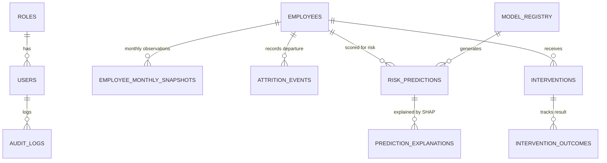

# Database Design Documentation — AttritionPulse AI

**System:** Longitudinal Employee Attrition Early-Warning and Explainable Risk Intelligence  
**Target RDBMS:** PostgreSQL 16 (production/Docker) & SQLite (local fallback)  
**ORM:** SQLAlchemy 2.0  
**Migration Tool:** Alembic  
**Date:** 2026-11-15  

---

## 1. Schema Overview

AttritionPulse AI employs a normalized, temporal schema designed for longitudinal employee tracking across 12 behavioral factors, event censoring, explainable ML predictions, and auditability.

---

## 2. Table Specifications

### 2.1. `roles` & `users`
- **Purpose**: RBAC authentication and access control.
- **Security**: Argon2id password hashing, JSON permissions array.
- **Constraints**: Unique `role_name`, `username`, and `email`.

### 2.2. `employees`
- **Purpose**: Immutable master record of employee tenure and non-sensitive corporate demographics.
- **Key Columns**: `id`, `employee_code` (unique), `department`, `job_role`, `business_unit`, `location`, `hire_date`, `employment_status`.
- **Convention**: No personal identifiers (PII) such as personal phone, SSN, or home address.

### 2.3. `employee_monthly_snapshots`
- **Purpose**: High-frequency longitudinal observation unit recording 12 attrition factors.
- **Uniqueness**: `UNIQUE(employee_id, snapshot_month)`.
- **Indexed**: Index on `(employee_id, snapshot_month)` and `snapshot_month`.
- **The Twelve Factors**:
  1. Overtime & Workload (`overtime_hours`, `contracted_work_hours`, `overtime_ratio`)
  2. Job Satisfaction (`job_satisfaction_score` [1-5], `satisfaction_change`)
  3. Work-Life Balance (`work_life_balance_score` [1-5], `weekend_work_days`, `after_hours_work_days`)
  4. Career Progression (`months_since_promotion`, `promotion_in_period`, `career_growth_satisfaction`)
  5. Compensation Fairness (`salary_amount`, `bonus_amount`, `pay_fairness_score`)
  6. Manager Support (`manager_support_score` [1-5], `one_to_one_meeting_count`, `manager_change_flag`)
  7. Employee Engagement (`engagement_score` [1-5], `motivation_score`, `meaningful_work_score`)
  8. Work Environment (`work_environment_score`, `safety_score`, `psychological_safety_score`)
  9. Attendance (`scheduled_work_days`, `absent_days`, `unplanned_absence_days`, `absence_rate`)
  10. Training & Development (`training_hours`, `skills_development_score`, `certification_count`)
  11. Travel & Commuting (`business_travel_days`, `commute_minutes_one_way`, `monthly_commute_hours`)
  12. Employee Wellbeing (`wellbeing_score`, `stress_score`, `exhaustion_score`, `recovery_score` - voluntary/sensitive)

### 2.4. `attrition_events`
- **Purpose**: Records ground-truth departure events with survival analysis censoring status.
- **Columns**: `event_date`, `event_type` (Voluntary, Involuntary, Retirement, Transfer), `voluntary_flag`, `observation_end_date`, `censoring_status` (1 = Event occurred, 0 = Censored).

### 2.5. `model_registry`, `risk_predictions`, & `prediction_explanations`
- **Purpose**: Auditable ML risk scoring and SHAP explainability attribution.
- **Model Registry**: Stores version, training metrics (ROC-AUC, PR-AUC, F1), artifact paths.
- **Predictions**: Captures prediction date, cutoff date, horizon (90-day), risk probability, risk category (Low/Moderate/High/Critical).
- **SHAP Explanations**: Stores feature contributions per prediction without overwriting historical runs.

### 2.6. `interventions` & `intervention_outcomes`
- **Purpose**: Closing the loop between predictive early warning and retention actions.
- **Tracks**: Assigned HR reviewer, planned date, status, notes, verification status, and outcome category.

### 2.7. `data_import_jobs` & `audit_logs`
- **Purpose**: Compliance, data provenance, and user access auditability.
