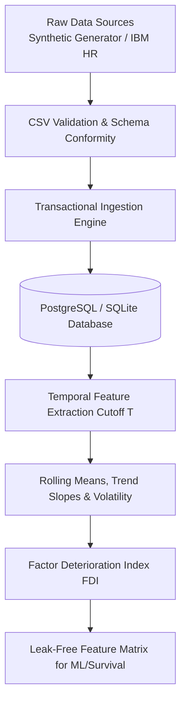

# Data Pipeline Architecture — AttritionPulse AI

**Module:** Longitudinal Data Engineering & Feature Processing  
**Date:** 2026-11-15  

---

## 1. Longitudinal Processing Workflow

---

## 2. Temporal Leakage Prevention Rules

1. **Strict Horizon Cutoff ($T$):**  
   For any prediction with cutoff date $T$, features are computed exclusively using snapshots where $\text{snapshot\_month} \le T$. No future observations or events occurring at $t > T$ are accessible to feature calculations.

2. **Lag-1 and Delta Operations:**  
   Changes are computed as $\Delta_{1m} = x_t - x_{t-1}$. If an employee has only one observation, $\Delta_{1m} = 0$.

3. **Trend Slopes:**  
   Calculated using Ordinary Least Squares linear regression across the prior 3 and 6 months:
   $$\text{slope} = \frac{\sum (t_i - \bar{t})(y_i - \bar{y})}{\sum (t_i - \bar{t})^2}$$

4. **Factor Deterioration Index (FDI):**  
   Synthesizes the directional velocity of risk across key factors:
   $$\text{FDI} = \frac{1}{K} \sum_{k=1}^K w_k \cdot \text{slope}_k$$
   Where deteriorating trends (falling satisfaction, rising overtime/stress) yield positive FDI scores.

---

## 3. IBM HR Dataset Integration Mapping

The static 1,470-row IBM HR dataset represents a cross-sectional snapshot. To integrate it into the longitudinal engine without fabricating historical records:
- Each IBM row is mapped as a single observation with simulated retrospective trajectories generated by `scripts/generate_synthetic_data.py`.
- Simulated records are explicitly tagged with `source_metadata: {"source": "IBM_SYNTHETIC_EXPANSION"}` to preserve scientific integrity.
