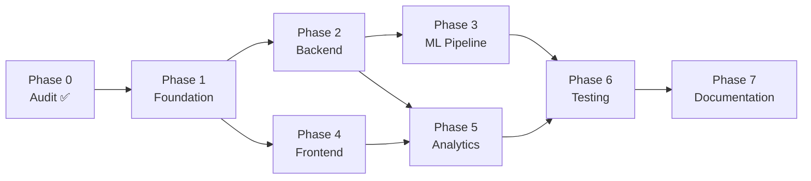

# Implementation Roadmap — AttritionPulse AI

**Date:** 2026-11-15  
**Status:** Proposed — awaiting approval before Phase 1

---

## Phase Overview

| Phase | Name | Focus | Estimated Effort |
|---|---|---|---|
| **0** | Repository Audit & Setup | ✅ Complete (this document) | Done |
| **1** | Foundation & Infrastructure | Docker, DB, project structure, migrations | 1–2 days |
| **2** | Backend Refactoring | Modular backend, proper API, services | 2–3 days |
| **3** | ML Pipeline Hardening | Reproducible training, model registry, retraining | 1–2 days |
| **4** | Frontend Migration to TypeScript | TSX conversion, TanStack Query, Plotly.js | 2–3 days |
| **5** | Advanced Analytics & Longitudinal Features | Cohort analysis, trend detection, risk scoring | 2–3 days |
| **6** | Testing & Quality | pytest, Vitest, Playwright, CI | 1–2 days |
| **7** | Documentation & Polish | README, API docs, user guide, final cleanup | 1 day |

---

## Phase 1 — Foundation & Infrastructure

### 1.1. Docker Compose Setup
- [ ] Create `docker-compose.yml` with PostgreSQL 16 service
- [ ] Add backend service with Dockerfile
- [ ] Add frontend service with Dockerfile
- [ ] Create `.env.example` with all required variables
- [ ] Verify PostgreSQL connectivity

### 1.2. Project Structure Migration
- [ ] Create target directory structure (`backend/app/`, `data/`, `scripts/`, etc.)
- [ ] Add `__init__.py` files to all Python packages
- [ ] Move backend source into `backend/app/`
- [ ] Move CSV dataset into `data/raw/`
- [ ] Remove duplicate CSV from `attritioniq/backend/`
- [ ] Update all import paths
- [ ] Verify existing functionality works with new structure

### 1.3. Database Setup
- [ ] Initialize Alembic in `backend/alembic/`
- [ ] Create initial migration from existing Employee model
- [ ] Replace `load_data.py` destructive seeding with safe Alembic + seed script
- [ ] Add `created_at`, `updated_at` to Employee model
- [ ] Create `prediction_history` table migration

### 1.4. Configuration
- [ ] Create `backend/app/config.py` with Pydantic Settings
- [ ] Replace hardcoded paths with configuration
- [ ] Replace CWD-relative model loading with config-based paths
- [ ] Create `AGENTS.md` for development guidelines

**Exit criteria:** `docker compose up` starts PostgreSQL + backend + frontend. Existing API endpoints respond correctly.

---

## Phase 2 — Backend Refactoring

### 2.1. Service Layer
- [ ] Extract `employee_service.py` from route handlers
- [ ] Extract `prediction_service.py` with proper error handling
- [ ] Extract `chat_service.py` — replace urllib with google-generativeai SDK
- [ ] Eliminate duplicate employee_dict construction (DRY)

### 2.2. ML Module Refactoring
- [ ] Create `ml/preprocessor.py` — shared preprocessing logic
- [ ] Create `ml/classifier.py` — XGBoost wrapper with model loading
- [ ] Create `ml/explainer.py` — SHAP wrapper
- [ ] Create `ml/survival.py` — Cox PH wrapper
- [ ] Load models once at startup via lifespan, not at import time

### 2.3. API Improvements
- [ ] Version all endpoints under `/api/v1/`
- [ ] Add proper request/response schemas for all endpoints
- [ ] Implement `/api/v1/upload` endpoint (currently missing)
- [ ] Add pagination to employee listing
- [ ] Add sorting and filtering to employee queries
- [ ] Add proper HTTP error responses with detail messages

### 2.4. Security Improvements
- [ ] Restrict CORS to configured origins
- [ ] Move Gemini API key from URL parameter to header
- [ ] Add request validation on all endpoints
- [ ] Add rate limiting middleware

**Exit criteria:** All API endpoints work under `/api/v1/`, ML models load once at startup, service layer handles business logic.

---

## Phase 3 — ML Pipeline Hardening

### 3.1. Training Pipeline
- [ ] Fix hardcoded file paths in `train_model.py` and `train_survival.py`
- [ ] Create `ml/trainer.py` with configurable paths
- [ ] Add model versioning (save with timestamp/hash)
- [ ] Add training metrics logging
- [ ] Create `scripts/train.py` CLI entry point

### 3.2. Model Registry
- [ ] Store trained models in `backend/app/ml/models/` with versioning
- [ ] Add model metadata (training date, metrics, dataset hash)
- [ ] Support model hot-reload without server restart

### 3.3. Enhanced ML Features
- [ ] Add feature importance aggregation across all employees
- [ ] Add SHAP summary plot data endpoint
- [ ] Add survival curve comparison endpoint (cohort vs individual)
- [ ] Add prediction confidence intervals

**Exit criteria:** Training is reproducible from any machine. Models are versioned and loaded reliably.

---

## Phase 4 — Frontend Migration to TypeScript

### 4.1. TypeScript Setup
- [ ] Add `tsconfig.json` and rename `.jsx` → `.tsx`
- [ ] Add TypeScript type definitions for all API responses
- [ ] Configure path aliases

### 4.2. Data Layer
- [ ] Replace raw axios + useEffect with TanStack Query
- [ ] Create typed API hooks for all endpoints
- [ ] Add loading/error/retry states

### 4.3. Chart Migration
- [ ] Replace Recharts with Plotly.js
- [ ] Create reusable chart components (bar, pie, area, waterfall)
- [ ] Connect Dashboard charts to live API data (replace hardcoded data)
- [ ] Add SHAP waterfall chart for per-employee explanations
- [ ] Add interactive survival curve with time slider

### 4.4. UI Improvements
- [ ] Add React Hook Form + Zod for all forms
- [ ] Add employee detail page with tabbed view
- [ ] Fix Upload page with working CSV upload
- [ ] Remove dead code (Sidebar.jsx, commented CSS, Vite starter code)
- [ ] Add responsive design for mobile

**Exit criteria:** All pages render with TypeScript, charts use Plotly.js with live data, forms validate with Zod.

---

## Phase 5 — Advanced Analytics & Longitudinal Features

### 5.1. Cohort Analysis Engine
- [ ] Create cohort definition API (by department, tenure, role, etc.)
- [ ] Add cohort comparison endpoints
- [ ] Build cohort analysis dashboard page

### 5.2. Trend Detection
- [ ] Add temporal risk tracking (store predictions over time)
- [ ] Implement risk trend calculation (rising, stable, declining)
- [ ] Add early warning alerts for rapidly rising risk scores
- [ ] Build trend visualization components

### 5.3. Statistical Analytics
- [ ] Add department-level risk aggregation (replace hardcoded Dashboard data)
- [ ] Add satisfaction correlation analysis
- [ ] Add attrition driver ranking across workforce
- [ ] Add what-if scenario modeling API

### 5.4. Report Generation
- [ ] Add CSV export for predictions
- [ ] Add PDF risk report generation
- [ ] Add scheduled report capability

**Exit criteria:** Cohort analysis works end-to-end. Dashboard shows live analytics. Trends are tracked over time.

---

## Phase 6 — Testing & Quality

### 6.1. Backend Tests
- [ ] Set up pytest with fixtures and test database
- [ ] Unit tests for ML preprocessing and prediction
- [ ] Unit tests for services
- [ ] Integration tests for API endpoints
- [ ] Test coverage target: ≥80%

### 6.2. Frontend Tests
- [ ] Set up Vitest + React Testing Library
- [ ] Component tests for all pages
- [ ] Hook tests for TanStack Query hooks
- [ ] Test coverage target: ≥70%

### 6.3. E2E Tests
- [ ] Set up Playwright
- [ ] E2E tests for critical flows: login → predict → explain → chat

### 6.4. CI Pipeline
- [ ] GitHub Actions workflow for backend tests
- [ ] GitHub Actions workflow for frontend tests + build
- [ ] Lint checks (ruff for Python, ESLint for TypeScript)

**Exit criteria:** All tests pass in CI. Coverage thresholds met.

---

## Phase 7 — Documentation & Polish

### 7.1. Documentation
- [ ] Rewrite README.md for AttritionPulse AI
- [ ] Add API documentation (FastAPI auto-docs + supplemental)
- [ ] Add user guide in docs/
- [ ] Add contributing guide

### 7.2. Final Cleanup
- [ ] Remove all dead code and commented blocks
- [ ] Optimize Docker images
- [ ] Performance audit (API response times, frontend bundle size)
- [ ] Security audit checklist
- [ ] Final version tagging

**Exit criteria:** Project is fully documented, clean, and production-ready.

---

## Dependencies Between Phases

> **Phases 2 and 4 can proceed in parallel** after Phase 1.  
> **Phase 5 requires both backend refactoring (Phase 2) and frontend migration (Phase 4).**  
> **Phase 3 can proceed alongside Phase 4.**
